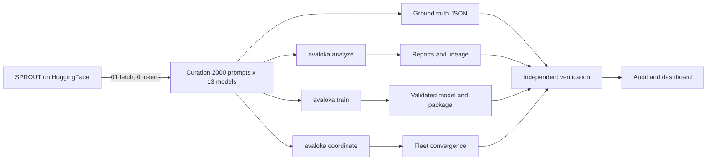

# Where does a frontier LLM actually earn its 62x?

**A reproducible routing-economics audit built with [Avaloka](https://github.com/guruvaidev/avaloka) 1.6 on real multi-LLM benchmark telemetry.**

Submitted to the Avaloka Engineering Intern Hackathon (14-15 Nov 2026) by **Prateek Sharma**.

---

## The question

Teams route an ever-growing share of production traffic across a ladder of models — a cheap default for most calls, a frontier model for the ones that matter. The intuition is that the expensive model is worth it on the "hard" requests.

This project asks the question with real numbers behind it:

> **Across 2,000 real benchmark prompts and 13 models, where does paying 50-60x more for a frontier model actually buy correctness — and can we tell, before the call runs, which requests deserve it?**

## The dataset

[**CARROT-LLM-Routing/SPROUT**](https://huggingface.co/datasets/CARROT-LLM-Routing/SPROUT) (HuggingFace) — a real LLM-routing benchmark. Each of the 6,637 test prompts was executed against **13 models** spanning three price tiers, with a judge-assigned correctness score (0-1) and the measured input/output token counts recorded per model.

From it I curate one analysis table, `data/sprout_llm_routing.csv`: **2,000 prompts x 31 columns**, each row carrying prompt structure, per-tier scores, exact per-turn API cost at 2026 list prices, and the frontier cost multiplier for that prompt. A second table, `data/sprout_pre_execution_routing.csv`, keeps **only what is known before the call runs** — the honest feature set for a routing model.

Fetching is $0 and uses **zero LLM tokens**: the numbers are downloaded once and cached. See `scripts/01_fetch_and_prepare_data.py`.

## Headline findings

1. **The price gap is real and stable; the accuracy gap is not.** Across the whole set, a frontier call costs a mean **$4.82 per 1,000 turns** against **$0.094** for the economy tier — a **62.6x** multiplier (individual prompts range from 5.98x to 446x). Yet the mean *accuracy* advantage of the best frontier model over the best economy model is only **+0.0179** on a 0-1 correctness scale.

   The distribution is more useful than the mean: on **70.0%** of prompts the cheapest model already scored ~1.0, the two tiers **tied on 84.0%**, the frontier model won on **9.2%** and **lost outright on 6.8%**. Paying 62x mostly bought a tie.

2. **The 62x is worth it in exactly one place — the code-writing role.** Mapping prompts to Avaloka's own agent roles, the frontier gain over `gpt-4o-mini` is:

   | Agent role | Frontier gain over gpt-4o-mini |
   |---|---:|
   | profiler | **+0.122** |
   | coder | **+0.073** |
   | summarizer | +0.014 |
   | planner | -0.001 |
   | validator | -0.036 |

   This independently reproduces the conclusion in Avaloka's own `docs/model-routing-cost.md`: **spend on the coder, leave the planner on the cheap model.** The planner is the largest prompt and the most expensive to upgrade, and here it buys a rounding error.

3. **Task domain, not prompt length, predicts whether the gap exists.** Frontier advantage by domain runs from **-0.237** (multi-step deduction, where a cheap model wins outright) to **+0.050** (multi-task knowledge) — a 29-point swing that a single global route setting cannot capture.

4. **A router is learnable from pre-call features alone.** `avaloka train` on the pre-execution table predicts `high_compute_route` at **roc_auc 0.956** (holdout) / **0.933 +/- 0.006** (CV) — against a **0.500** trivial baseline, and certified **level 4/4** by Avaloka's Validator.

5. **The evidence layer earns its keep.** Adding one post-call column drops the claimed score to a suspiciously perfect **1.0000** — and Avaloka's Skeptic rejects it: verdict **FAIL**, the leaking column named, ceiling capped at **1/4**.

## How it was built



Every stage writes inspectable, versioned files to disk. See [`SPEC.md`](SPEC.md) for the full pipeline and [`TRACKER.md`](TRACKER.md) for the live status.

## Results, verified two ways

Every figure Avaloka reports was checked against deterministic Python arithmetic in `scripts/02_verify_ground_truth.py` (`artifacts/ground_truth_metrics.json`). Where the two agree, the number is trustworthy; the pipeline never lets a model invent a figure.

| Claim | Value | Evidence |
|---|---|---|
| Mean frontier cost / 1k turns | $4.8188 | `artifacts/ground_truth_metrics.json` |
| Mean economy cost / 1k turns | $0.0939 | same |
| Mean frontier cost multiplier | 62.58x | same |
| Mean frontier advantage | +0.01785 | same |
| Routing model holdout roc_auc | 0.9560 | `artifacts/avaloka-train-clean/model_card.md` |
| Routing model CV roc_auc | 0.933 +/- 0.006 | same |
| Baseline roc_auc | 0.500 | `validation_report.json` |
| Leaky model verdict | FAIL, level 1/4 | `artifacts/avaloka-train-leaky/validation_report.json` |
| Fleet | 4 sub-Avalokas, 2,000 rows, pass | `artifacts/avaloka-fleet/coordination.json` |

## Engineering audit — what worked and what didn't

Reproducible with `python scripts/03_reproduce_edge_cases.py` (4/4 contract checks hold, 1/1 declared gap reproduced). Full detail in [`audit/ENGINEERING_AUDIT.md`](audit/ENGINEERING_AUDIT.md).

- **Holds:** post-call leakage blocked by name (DQ-01); a mandatory baseline on the confidence interval (DQ-05); an unresolved measure disclosed with candidates instead of answered with a row count (#475); `"None"` preserved as a category across 1,631 rows (#474/#479).
- **Reproduced gap:** the spreadsheet reader picks a sheet by cell count, not by the question (`xlsx_decoy_sheet_outweighs_the_answer`) — and, newly observed, `workload.peek()` counts newline bytes in the xlsx ZIP container, so the sizing line speaks a confident `99 rows` for a workbook whose sheet has 400. Root causes and a suggested fix are in the audit.
- **New finding — the verdict never asks whether the question was answered.** The Validator has eight checks for whether a result is safe, and none for whether the goal was answered. An unanswerable goal therefore ships `status: "limited"` in `goal_analysis.json` and `verdict: "pass"` in `validation_report.json`, from the same run. Reproduced three ways; the five-line fix is in the audit.

## Reproduce it

```bash
git clone https://github.com/guruvaidev/avaloka.git .avaloka-src
python -m venv .venv
.venv/Scripts/pip install -e ".avaloka-src[formats,benchmark,dev]"

python scripts/01_fetch_and_prepare_data.py     # data (no LLM, no key)
python scripts/02_verify_ground_truth.py        # ground truth
.venv/Scripts/avaloka analyze data/sprout_llm_routing.csv --goal "average frontier_gain_over_mini by agent_role"
.venv/Scripts/avaloka train   data/sprout_pre_execution_routing.csv --target high_compute_route --deployable
.venv/Scripts/avaloka coordinate data/sprout_llm_routing.csv --workers 4 --goal "average frontier_gain_over_mini by agent_role"
python scripts/03_reproduce_edge_cases.py       # audit
```

Python 3.11 or 3.12. No API key: the CLI runs fully offline, and every number here was produced that way.

## Layout

| Path | What it is |
|---|---|
| `data/` | The curated dataset (`csv`, `parquet`, multi-sheet `xlsx`) + `provenance.json` with SHA-256s |
| `scripts/` | The three-stage pipeline (fetch, verify, edge-case audit) |
| `artifacts/` | Verbatim Avaloka bundles — `analyze`, `train` (clean + leaky), `coordinate` |
| `audit/` | The engineering audit + raw CLI logs |
| `index.html` | Self-contained interactive report (open in any browser) |
| `SPEC.md` / `TRACKER.md` | Research spec and live status |

## Source

Dataset: [CARROT-LLM-Routing/SPROUT](https://huggingface.co/datasets/CARROT-LLM-Routing/SPROUT), used under its published terms. Model prices are 2026 list snapshots, stated per turn and labelled as such.

## Licence

Analysis code and documentation: MIT. Avaloka itself is Apache-2.0 (see the upstream repository).
